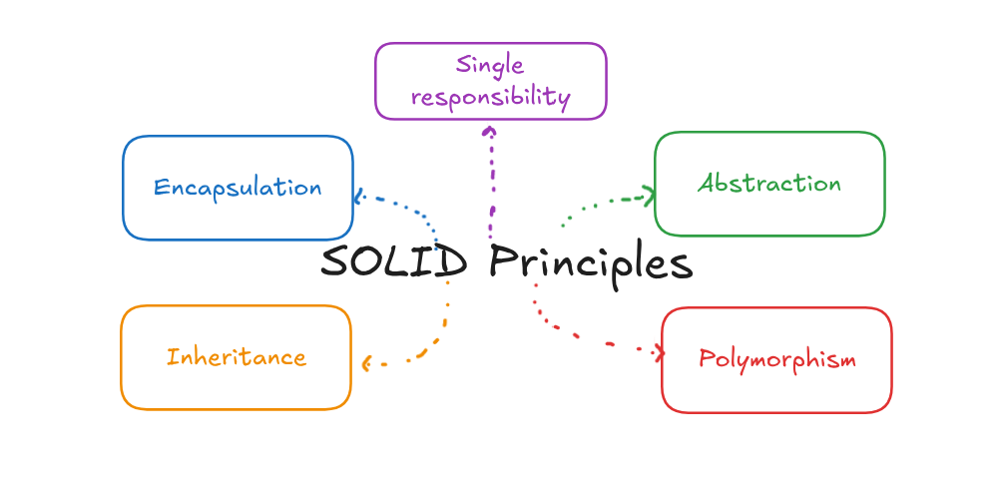

# 0. Introduction to SOLID

## Concept

SOLID is a set of five design principles for writing object-oriented code that is clean, flexible, and easy to maintain. Each letter stands for one principle.

---

## Background

In the early 2000s, Robert C. Martin (known as Uncle Bob) collected a group of principles that he believed every developer should follow to keep code clean and free of recurring design problems. Later, Michael Feathers arranged the first five of them into the acronym **SOLID**.

Each principle has its own goal and its own advice on how to improve and develop software, so that the code stays easy to modify, easy to extend, and easy to add new features to.

| Letter | Principle | One-line meaning |
|---|---|---|
| S | Single Responsibility | A class should have only one reason to change |
| O | Open / Closed | Open for extension, closed for modification |
| L | Liskov Substitution | A child class must be able to replace its parent without breaking the program |
| I | Interface Segregation | Prefer many small, specific interfaces over one big one |
| D | Dependency Inversion | Depend on abstractions, not on concrete classes |

---

## Coupling

Before going through the principles, there is one term that appears in almost all of them: **coupling**.

### Concept

Coupling describes how much two parts of the code depend on each other.

### Explanation

Take two classes, A and B:

- **Tight (high) coupling**: A and B depend heavily on each other. They have a strong relationship, so if one of them changes, the other usually has to change too.
- **Loose (low) coupling**: A and B depend on each other as little as possible, typically only through an abstraction such as an interface. One can change without forcing a change in the other.

Coupling is not limited to classes. It applies to methods, functions, and any two components in the code. High coupling is a design problem, because every change spreads to other places. The goal is always low coupling, and most of the SOLID principles are different ways of reaching it.

### Code (C++)

```cpp
#include <iostream>
#include <string>
using namespace std;

class EmailSender {
public:
    void send(const string& message) {
        cout << "Email: " << message << "\n";
    }
};

// Tight coupling: Order creates and depends on a concrete EmailSender
class Order {
    EmailSender sender;
public:
    void confirm() {
        sender.send("Order confirmed");
    }
};

int main() {
    Order order;
    order.confirm();
}
```

If the system later has to send an SMS instead of an email, `Order` itself must be edited. Files 2 and 5 show how to remove this dependency.

---

## How SOLID Relates to the OOP Pillars

SOLID is not a replacement for the four pillars of OOP. It builds on them. The pillars are the tools, and SOLID tells you how to use those tools well.

<p align="center">
  
</p>


| Principle | Main pillars it relies on |
|---|---|
| Single Responsibility | Encapsulation |
| Open / Closed | Abstraction, Polymorphism, Inheritance |
| Liskov Substitution | Inheritance, Polymorphism |
| Interface Segregation | Abstraction |
| Dependency Inversion | Abstraction, Polymorphism |

---

## Summary

- SOLID is five principles that make object-oriented code easier to maintain, extend, and test.
- The principles were collected by Uncle Bob, and the acronym was created by Michael Feathers.
- Tight coupling means changes spread between components. Loose coupling means components can change independently.
- The principles use the four pillars of OOP as their tools.
