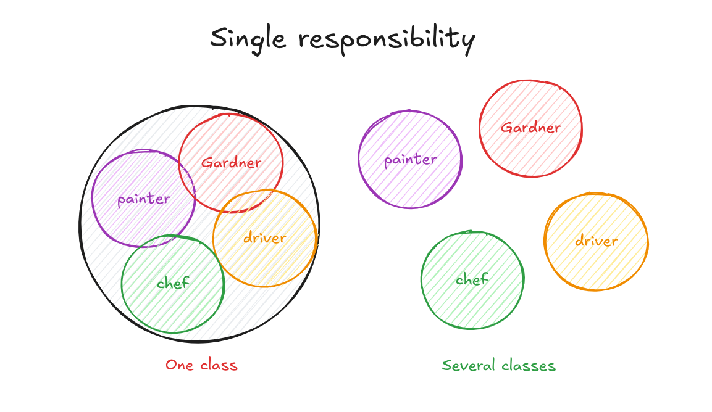

# 1. Single Responsibility Principle (SRP)

## Concept

A class should have only one responsibility. In other words, it should have only one reason to change.

---

## Explanation

If a class does only one thing, it will naturally have only one reason to change. If a class does several things, it has several reasons to change, one for each thing it does.

Imagine a robot that works as a chef, a gardener, a painter, and a driver at the same time. Every time you want to change one of those jobs, you have to open and edit the same robot. That breaks the Single Responsibility Principle. Compare that to having a separate robot for each job. Each robot has one function, so if the painting needs to change, you go to the painter robot and edit it directly, without touching the others.

The same applies to classes: one class, one job, one reason to change.

<p align="center">
  
</p>

---

### What Counts as a Responsibility

A responsibility is a reason for the class to change. A useful question to ask is: "Who or what could force me to edit this class?" If the answer is more than one thing (the pricing rules, the report layout, the storage format), the class has more than one responsibility.

### Benefits

1. **Easier testing**: fewer functions in a class means fewer test cases, and the tests are clearer.
2. **Lower coupling**: with fewer functionalities in each class, there are fewer dependencies between classes.
3. **Readability**: classes are smaller, organized, and each one clearly expresses what it does, which leads to cleaner code.
4. **Divide and conquer**: working with several small classes is much easier than working with one large module.
5. **Error isolation**: if everything sits in one block, an error in one part can affect the whole block, like an infection spreading. Separate classes keep the damage contained.
6. **Easier changes**: adding or modifying a feature in one place does not force you to edit many other places.

---

## Code (C++)

A class with three responsibilities:

```cpp
#include <iostream>
#include <vector>
#include <numeric>
#include <fstream>
#include <string>
using namespace std;

// Violates SRP: this class has three reasons to change
class Invoice {
    vector<double> items;
public:
    void addItem(double price) { items.push_back(price); }

    double calculateTotal() const {              // changes when pricing or tax rules change
        return accumulate(items.begin(), items.end(), 0.0);
    }

    void print() const {                         // changes when the layout changes
        cout << "Total: " << calculateTotal() << "\n";
    }

    void saveToFile(const string& path) const {  // changes when the storage changes
        ofstream out(path);
        out << calculateTotal();
    }
};

int main() {
    Invoice inv;
    inv.addItem(20);
    inv.addItem(30);
    inv.print();
}
```

The same code with each responsibility in its own class:

```cpp
#include <iostream>
#include <vector>
#include <numeric>
#include <fstream>
#include <string>
using namespace std;

// Responsibility 1: the invoice data and its calculation
class Invoice {
    vector<double> items;
public:
    void addItem(double price) { items.push_back(price); }

    double calculateTotal() const {
        return accumulate(items.begin(), items.end(), 0.0);
    }
};

// Responsibility 2: how the invoice is displayed
class InvoicePrinter {
public:
    void print(const Invoice& invoice) const {
        cout << "Total: " << invoice.calculateTotal() << "\n";
    }
};

// Responsibility 3: how the invoice is stored
class InvoiceRepository {
public:
    void save(const Invoice& invoice, const string& path) const {
        ofstream out(path);
        out << invoice.calculateTotal();
    }
};

int main() {
    Invoice inv;
    inv.addItem(20);
    inv.addItem(30);

    InvoicePrinter printer;
    printer.print(inv);

    InvoiceRepository repo;
    repo.save(inv, "invoice.txt");
}
```

Now a change in the layout only touches `InvoicePrinter`, a change in storage only touches `InvoiceRepository`, and a change in the calculation only touches `Invoice`.

---

## Summary

- One class, one responsibility, one reason to change.
- Ask "what could force me to edit this class?" If there is more than one answer, split it.
- The result is easier testing, lower coupling, clearer code, and errors that stay contained.
- Do not take it to the extreme: splitting a class into dozens of tiny pieces that cannot be understood together is also a problem.
