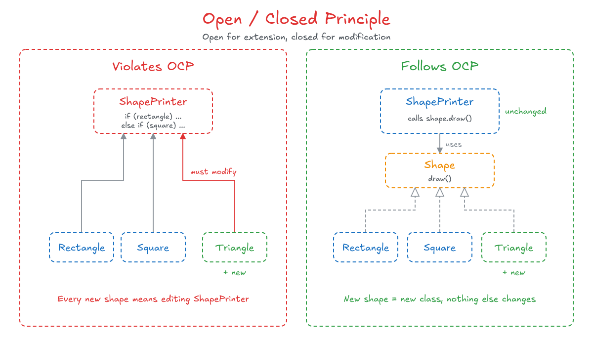

# 2. Open / Closed Principle (OCP)

## Concept

Software entities (classes, modules, functions, etc.) should be open for extension but closed for modification.

---

## Explanation

I should be able to add new behavior and new features, but to add them I should not have to edit or change the code I already have.

Imagine a robot that can cut. If I modify it so that it now only paints, I changed its whole functionality and lost what it did before. That is wrong. If I extend it, so it can do cut and paint, I added something new and kept the old behavior intact.

Note the difference between this principle and the Single Responsibility Principle. Here, the robot means a **module**, not one specific class. The idea is simply that I can add features and extensions without modifying what already exists.

### How to Apply It

To apply this principle we need **abstraction** and **polymorphism** (files 4 and 5 of the OOP notes).

Suppose I have a `Rectangle` class, a `Square` class, and a third class called `ShapePrinter` with a function that receives a shape and draws it. Inside that function: if the shape is a rectangle, do this, else if the shape is a square, do that.

What do we notice? Every time I add a new shape, I have to go back and edit the `ShapePrinter` function. That is an obvious violation: the printer is open for modification.

To fix it, we use abstraction:

1. Create an abstract class (or interface) called `Shape`, which did not exist before. It contains an abstract function `draw()`. Its implementation is hidden.
2. `Rectangle` and `Square` extend `Shape` and override `draw()`. They are forced to, because it is abstract.
3. `ShapePrinter` now receives a `Shape` and just calls `shape.draw()`. It no longer cares which kind of shape it received. The implementation lives inside each class.

When a new shape is added later, I only add a new class that extends `Shape`. `ShapePrinter` is never touched.

Polymorphism is what makes this work: a `Shape` reference can hold a `Square`, a `Rectangle`, a `Triangle`, or any future shape, and the correct `draw()` runs each time.

<p align="center">
  
</p>

Instead of an abstract class, an interface works just as well. The whole idea is that I extend, and never modify.

### Another Example

If I have a guitar and want a modified guitar, I should not modify the original `Guitar` class. I create a new class that inherits from `Guitar`, and that is the modified one. The original guitar is untouched.

### Benefits

- The code stays maintainable, readable, and reusable.
- When requirements change later, existing code is not touched, so there is much less risk of breaking it.

---

## Code (C++)

Before: the printer has to be edited for every new shape.

```cpp
#include <iostream>
using namespace std;

enum class ShapeType { Rectangle, Square };

struct Shape {
    ShapeType type;
};

class ShapePrinter {
public:
    void draw(const Shape& shape) const {
        if (shape.type == ShapeType::Rectangle) {
            cout << "Drawing a rectangle\n";
        } else if (shape.type == ShapeType::Square) {
            cout << "Drawing a square\n";
        }
        // a new shape means a new "else if" here, and a new enum value
    }
};

int main() {
    ShapePrinter printer;
    printer.draw(Shape{ShapeType::Rectangle});
    printer.draw(Shape{ShapeType::Square});
}
```

After: `ShapePrinter` is closed for modification, and new shapes are added by extension.

```cpp
#include <iostream>
using namespace std;

class Shape {                              // abstract class
public:
    virtual ~Shape() = default;
    virtual void draw() const = 0;         // implementation is hidden
};

class Rectangle : public Shape {
public:
    void draw() const override { cout << "Drawing a rectangle\n"; }
};

class Square : public Shape {
public:
    void draw() const override { cout << "Drawing a square\n"; }
};

class ShapePrinter {                       // never needs to change
public:
    void draw(const Shape& shape) const {
        shape.draw();                      // polymorphism picks the right version
    }
};

// A new shape, added later. Nothing above was edited.
class Triangle : public Shape {
public:
    void draw() const override { cout << "Drawing a triangle\n"; }
};

int main() {
    ShapePrinter printer;

    Rectangle rectangle;
    Square square;
    Triangle triangle;

    printer.draw(rectangle);
    printer.draw(square);
    printer.draw(triangle);

    Shape* shape = new Square();           // polymorphism: Shape holds a Square
    printer.draw(*shape);
    delete shape;
}
```

---

## Summary

- Open for extension: new behavior can be added.
- Closed for modification: existing, tested code is not edited to add it.
- It is achieved through abstraction (an abstract class or interface) and polymorphism.
- Whenever you see a growing chain of `if / else if` that checks the type of an object, it is a sign the principle is being violated.
