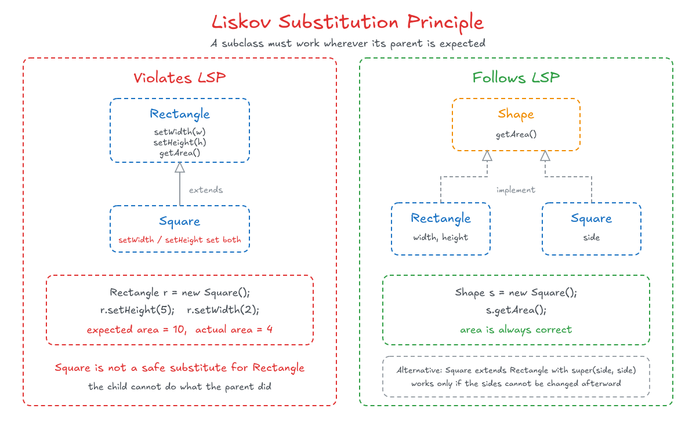

# 3. Liskov Substitution Principle (LSP)

## Concept

If S is a subtype of T, then objects of type T in a program may be replaced with objects of type S without altering any of the desirable properties of that program.

In simple words: a child class must be able to take the place of its parent and do the same job, without breaking anything.

---

## Explanation

Say `T` is a parent class and `S` is its child class. Then I can use an `S` object wherever a `T` object is expected:

```cpp
T* ob1 = new T();
T* ob2 = new S();     // valid: this is polymorphism
```

Writing this is fine and compiles without any problem. The principle goes further: the program must also **behave correctly** after the substitution.

### Analogy: Sam and Aiden

Take two robots: Sam (the parent) and Aiden (the child). Someone asks Sam to make coffee, and Sam knows how, so he makes it. Now suppose Sam is not available. Can Aiden make coffee? He should be able to. He can even make something similar, like a cappuccino, and that does not hurt the request as long as it is suitable. But if Aiden could not make coffee at all, then he violated the Liskov Substitution Principle.

If the parent is not available, the child can take its place and do the same role. A child can do the same as its parent, or more, but never less.

### Example: Rectangle and Square

Suppose I have a `Rectangle` class with `setWidth()`, `setHeight()`, and `getArea()`.

Mathematically, a square is a special kind of rectangle, where the width equals the height. So I make `Square` inherit from `Rectangle`. Because the two sides must always be equal, `Square` overrides `setWidth()` and `setHeight()` so that each one sets both values.

In `main`, I create a rectangle and give it a width and a height. The test says: if the area equals 10 when I set 2 and 5, everything is fine. That works for a normal `Rectangle`.

Using a `Square` through a `Rectangle` reference (`Rectangle& r = square;`) is not a problem in itself, because it is polymorphism. The problem appears when I call the setters on it:

1. Set the height to 5. On a `Square` this sets both sides to 5.
2. Set the width to 2. On a `Square` this sets both sides to 2.

The last call overwrites the first. The area is 4, not 10, and the check on the area fails. The code that was written for `Rectangle` no longer works when it receives a `Square`.

So the child could not do what the parent did. That is a violation of the Liskov Substitution Principle, even though mathematically a square is a rectangle. In code, "is-a" means "behaves like", not just "is similar to".

### The Fix

Notice that the fix uses interfaces and abstraction again.

1. Create an interface called `Shape` with a `getArea()` function.
2. `Rectangle` implements `Shape` and overrides `getArea()`.
3. `Square` also implements `Shape`, in the same way as `Rectangle`.

Now neither class pretends to be the other. Each one follows the `Shape` contract and calculates its own area, so any code that uses a `Shape` always works.

### Another Option

`Square` could extend `Rectangle` and call `super(side, side)` in its constructor, so it still has its own way of building itself. This also solves the problem here, but it is not necessarily the right solution every time. It only works safely if the sides cannot be changed after creation. If `Rectangle` still exposes `setWidth()` and `setHeight()`, the violation comes back.

<p align="center">
  
</p>

---

### A Note on Applying It

This principle looks easy in theory, but it is one of the hardest to apply in practice. It also depends on your business and the software you are building. Not every method belongs in an interface every time, so the decision depends on the case.

---

## Code (C++)

The violation:

```cpp
#include <iostream>
using namespace std;

class Rectangle {
protected:
    double width, height;
public:
    Rectangle(double w, double h) : width(w), height(h) {}
    virtual ~Rectangle() = default;

    virtual void setWidth(double w)  { width = w; }
    virtual void setHeight(double h) { height = h; }
    double getArea() const { return width * height; }
};

class Square : public Rectangle {
public:
    Square(double side) : Rectangle(side, side) {}

    void setWidth(double w) override  { width = height = w; }   // sets both
    void setHeight(double h) override { width = height = h; }   // sets both
};

// Written for Rectangle: expects an area of 10 after these calls
void test(Rectangle& r) {
    r.setHeight(5);
    r.setWidth(2);
    cout << "Area: " << r.getArea() << " (expected 10)\n";
}

int main() {
    Rectangle rec(1, 1);
    test(rec);       // Area: 10 (expected 10)

    Square sq(3);
    test(sq);        // Area: 4  (expected 10)  <- LSP violated
}
```

The fix, using an interface:

```cpp
#include <iostream>
using namespace std;

class Shape {                                   // interface
public:
    virtual ~Shape() = default;
    virtual double getArea() const = 0;
};

class Rectangle : public Shape {
    double width, height;
public:
    Rectangle(double w, double h) : width(w), height(h) {}
    double getArea() const override { return width * height; }
};

class Square : public Shape {
    double side;
public:
    Square(double s) : side(s) {}
    double getArea() const override { return side * side; }
};

void printArea(const Shape& shape) {
    cout << "Area: " << shape.getArea() << "\n";
}

int main() {
    Rectangle rec(2, 5);
    Square sq(3);

    printArea(rec);    // Area: 10
    printArea(sq);     // Area: 9
}
```

The other option: `Square` extends `Rectangle`, with no setters that could break the equality of the sides.

```cpp
#include <iostream>
using namespace std;

class Rectangle {
protected:
    double width, height;
public:
    Rectangle(double w, double h) : width(w), height(h) {}
    virtual ~Rectangle() = default;
    double getArea() const { return width * height; }   // no setters
};

class Square : public Rectangle {
public:
    explicit Square(double side) : Rectangle(side, side) {}
};

int main() {
    Rectangle rec(2, 5);
    Square sq(3);
    cout << rec.getArea() << " " << sq.getArea() << "\n";   // 10 9
}
```

---

## Summary

- A child class must be usable anywhere its parent is expected, and the program must still behave correctly.
- A child can do the same as the parent, or more, but never less.
- The Rectangle and Square case shows that "is-a" in math is not always "is-a" in code.
- The usual fix is to depend on a shared abstraction (`Shape`) instead of forcing one class to inherit from the other.
- It is one of the hardest principles to apply, and the right design depends on the business.
