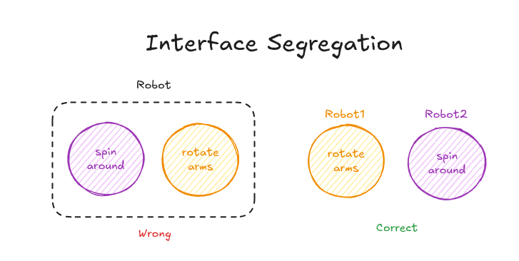
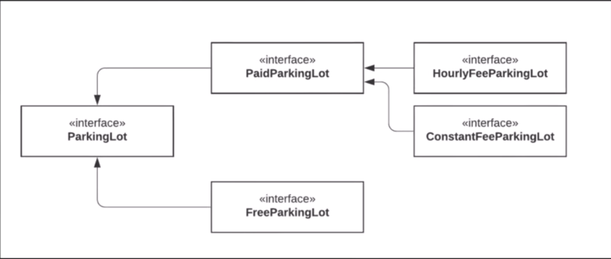

# 4. Interface Segregation Principle (ISP)

## Concept

Split interfaces that are very large into smaller and more specific ones, so that clients only have to know about the methods that are of interest to them.

---

## Explanation

Segregation means separating or isolating things from each other. If I have a big interface, I divide it into several small and specific ones.

The word **clients** here means any concrete class that implements the interface. The goal is that each client only has to implement the methods it actually cares about, and is never forced to take all of them.

This is usually one of the easier principles to apply.

### Example 1: Robots

Say I have robots that perform certain functions, and I declare that every robot can spin around and can rotate its arms. If one robot cannot do all of these features, I have a problem: it is forced to have something it cannot do. That violates the Interface Segregation Principle.

Instead, I split the features. One interface for spinning and another for rotating arms. A robot that can spin around implements the first, and a robot that can rotate its arms implements the second. Each robot only takes what is specific to it, and not every robot is forced to do the same features.

<p align="center">
  
</p>

---

### Example 2: Parking Lot

Say I have a `ParkingLot` interface with functions to park a car, unpark a car, get the capacity, calculate the fee, and do the payment.

In the business, I may also have a kind of parking that is free. When `FreeParkingLot` implements the interface, it has no fee to calculate, so `calculateFee()` just returns zero and `doPayment()` does nothing. I was forced to implement methods that I will never use, only because the interface contains them.

The solution is to break the interface into smaller ones:

- `ParkingLot`: the basics every parking lot has (park, unpark, capacity).
- `PaidParkingLot` extends `ParkingLot`: adds the fee calculation and the payment.
- `FreeParkingLot` extends `ParkingLot`: nothing else is needed.
- `HourlyFeeParkingLot` and `ConstantFeeParkingLot` extend `PaidParkingLot`: they implement the two different ways of calculating the fee.

Now every class implements only the methods that make sense for it.

<p align="center">
  
</p>

This is one possible solution. Depending on the business situation or the software you are working on, there may be another solution that fits better.

---

## Code (C++)

Example 1, the robots. One big interface forces a robot to pretend it can do something it cannot:

```cpp
#include <iostream>
using namespace std;

// Violates ISP: every robot must be able to do both
class Robot {
public:
    virtual ~Robot() = default;
    virtual void spinAround() = 0;
    virtual void rotateArms() = 0;
};

class SpinningRobot : public Robot {
public:
    void spinAround() override { cout << "Spinning around\n"; }
    void rotateArms() override { /* cannot do this, but forced to implement it */ }
};

int main() {
    SpinningRobot robot;
    robot.spinAround();
    robot.rotateArms();      // does nothing, and it is misleading
}
```

After splitting the interface:

```cpp
#include <iostream>
using namespace std;

class CanSpin {
public:
    virtual ~CanSpin() = default;
    virtual void spinAround() = 0;
};

class CanRotateArms {
public:
    virtual ~CanRotateArms() = default;
    virtual void rotateArms() = 0;
};

class Robot1 : public CanRotateArms {
public:
    void rotateArms() override { cout << "Robot1 rotates its arms\n"; }
};

class Robot2 : public CanSpin {
public:
    void spinAround() override { cout << "Robot2 spins around\n"; }
};

// A robot that can do both simply implements both interfaces
class Robot3 : public CanSpin, public CanRotateArms {
public:
    void spinAround() override { cout << "Robot3 spins around\n"; }
    void rotateArms() override { cout << "Robot3 rotates its arms\n"; }
};

int main() {
    Robot1 r1;
    Robot2 r2;
    Robot3 r3;
    r1.rotateArms();
    r2.spinAround();
    r3.spinAround();
    r3.rotateArms();
}
```

Example 2, the parking lot. One big interface:

```cpp
#include <iostream>
#include <string>
using namespace std;

// Violates ISP: free parking lots are forced to deal with fees
class ParkingLot {
public:
    virtual ~ParkingLot() = default;
    virtual void park(const string& plate) = 0;
    virtual void unpark(const string& plate) = 0;
    virtual int getCapacity() const = 0;
    virtual double calculateFee(const string& plate) const = 0;
    virtual void doPayment(const string& plate, double amount) = 0;
};

class FreeParkingLot : public ParkingLot {
public:
    void park(const string& plate) override   { cout << plate << " parked\n"; }
    void unpark(const string& plate) override { cout << plate << " left\n"; }
    int getCapacity() const override          { return 50; }

    double calculateFee(const string&) const override { return 0; }   // forced, meaningless
    void doPayment(const string&, double) override {}                 // forced, meaningless
};

int main() {
    FreeParkingLot lot;
    lot.park("ABC-123");
    cout << "Fee: " << lot.calculateFee("ABC-123") << "\n";
}
```

After segregation:

```cpp
#include <iostream>
#include <string>
using namespace std;

class ParkingLot {                                   // the basics
public:
    virtual ~ParkingLot() = default;
    virtual void park(const string& plate) = 0;
    virtual void unpark(const string& plate) = 0;
    virtual int getCapacity() const = 0;
};

class PaidParkingLot : public ParkingLot {           // adds only what paid lots need
public:
    virtual double calculateFee(const string& plate) const = 0;
    virtual void doPayment(const string& plate, double amount) = 0;
};

class FreeParkingLot : public ParkingLot {           // nothing extra to implement
public:
    void park(const string& plate) override   { cout << plate << " parked for free\n"; }
    void unpark(const string& plate) override { cout << plate << " left\n"; }
    int getCapacity() const override          { return 50; }
};

class HourlyFeeParkingLot : public PaidParkingLot {
    double ratePerHour = 10;
    int hoursParked = 3;                             // simplified for the example
public:
    void park(const string& plate) override   { cout << plate << " parked (hourly)\n"; }
    void unpark(const string& plate) override { cout << plate << " left\n"; }
    int getCapacity() const override          { return 100; }

    double calculateFee(const string&) const override { return ratePerHour * hoursParked; }
    void doPayment(const string& plate, double amount) override {
        cout << plate << " paid " << amount << "\n";
    }
};

class ConstantFeeParkingLot : public PaidParkingLot {
    double fee = 25;
public:
    void park(const string& plate) override   { cout << plate << " parked (flat fee)\n"; }
    void unpark(const string& plate) override { cout << plate << " left\n"; }
    int getCapacity() const override          { return 80; }

    double calculateFee(const string&) const override { return fee; }
    void doPayment(const string& plate, double amount) override {
        cout << plate << " paid " << amount << "\n";
    }
};

int main() {
    FreeParkingLot free;
    free.park("AAA-111");

    HourlyFeeParkingLot hourly;
    hourly.park("BBB-222");
    hourly.doPayment("BBB-222", hourly.calculateFee("BBB-222"));
}
```

---

## Summary

- Many small, specific interfaces are better than one large interface.
- A class should never be forced to implement a method it does not use.
- If an implementation has an empty method, or one that just returns zero, the interface is probably too big.
- The way to split depends on the business, and more than one design can be correct.
