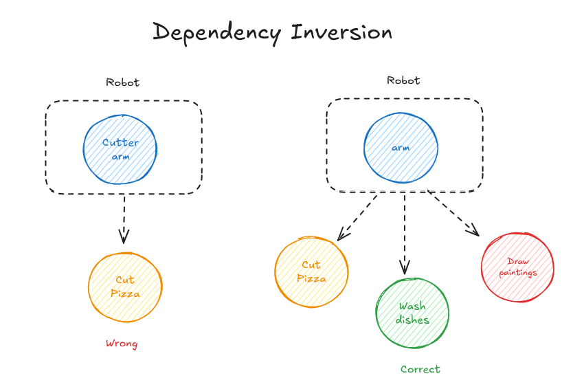

# 5. Dependency Inversion Principle (DIP)

## Concept

1. High-level modules should not depend on low-level modules. Both should depend on abstractions.
2. Abstractions should not depend on details. Details (concrete implementations) should depend on abstractions.

---

## Explanation

The name means that the usual direction of dependency is reversed (inverted).

- A **high-level module** contains the main logic, the decisions of the application.
- A **low-level module** contains the details: how a specific job is actually done.

Neither of them should depend directly on the other. Both should depend on an abstraction (an interface or an abstract class). And the abstraction itself should not depend on the details of the concrete classes. It is the concrete classes that must depend on the abstraction, and not the other way around.

### Analogy: The Pizza Robot

Say I have a robot that claims it can cut pizza with its "pizza cutter arm". That breaks the principle. The problem is that the cutter arm is part of the robot, so to do its job (cutting pizza) the robot depends on that specific arm. There is no flexibility: it can only do that one thing.

What the robot should have is an empty hand, so it can hold any tool and use it for any job.

- "I can cut pizza with my pizza cutter arm" is wrong.
- "I cut pizza with any tool given to me" is correct.

Now the robot no longer depends on the detail (the specific arm or tool). It depends on an abstraction, "a hand that can hold a tool", and any tool can be placed in it. The robot and the tool are no longer tied to each other.

<p align="center">
  
</p>

---

### Example: Delivery Company and Delivery Driver

Say I have a `DeliveryCompany` class with a function `sendProduct()`. It takes a product and gives it to a `DeliveryDriver` object, which has a function `deliverProduct()` that does the delivery.

Here is the problem: `DeliveryCompany` creates and uses a concrete `DeliveryDriver`. The two classes now depend on each other. If the company later wants to deliver with a drone, a motorcycle, or a courier service, the company class itself has to be edited.

The solution is to introduce an abstraction:

1. Create an interface `DeliveryService` with a function `deliverProduct()`.
2. `DeliveryDriver` implements `DeliveryService` and overrides `deliverProduct()`.
3. Refactor `DeliveryCompany`. It does not hold a driver anymore. It holds a `DeliveryService`, receives it through its constructor, and uses it inside `sendProduct()`:
   `this.deliveryService.deliverProduct()` (in C++: `service.deliverProduct()`).

Which one is the high-level module and which is the low-level one? In this case, `DeliveryCompany` is the high level, because it contains the main logic, and `DeliveryDriver` is the low level, because it contains the detail of how the delivery is done. After the change, both depend on `DeliveryService`, and the two concrete classes are separated from each other. The concrete classes depend on the interface, not the opposite.

### Dependency Inversion vs. Dependency Injection

The two names sound similar, but they are different things:

- **Dependency Inversion** is the principle: depend on abstractions.
- **Dependency Injection** is a technique for applying it: the object receives what it needs from outside (usually through the constructor), instead of creating it itself. That is what `DeliveryCompany` does above.

### Benefits

- The classes are loosely coupled, so a change in one does not force a change in the other.
- A new implementation can be added without editing the high-level code, which also supports the Open / Closed Principle.
- Testing is easier, because a fake implementation can be passed in place of the real one.

---

## Code (C++)

Before: the company depends directly on the concrete driver.

```cpp
#include <iostream>
#include <string>
using namespace std;

class DeliveryDriver {
public:
    void deliverProduct(const string& product) {
        cout << "Driver delivers " << product << "\n";
    }
};

class DeliveryCompany {
    DeliveryDriver driver;                    // depends on a concrete class
public:
    void sendProduct(const string& product) {
        driver.deliverProduct(product);
    }
};

int main() {
    DeliveryCompany company;
    company.sendProduct("Laptop");
}
```

After: both depend on the `DeliveryService` abstraction.

```cpp
#include <iostream>
#include <string>
using namespace std;

class DeliveryService {                       // the abstraction
public:
    virtual ~DeliveryService() = default;
    virtual void deliverProduct(const string& product) = 0;
};

// Low-level modules: details that depend on the abstraction
class DeliveryDriver : public DeliveryService {
public:
    void deliverProduct(const string& product) override {
        cout << "Driver delivers " << product << "\n";
    }
};

class DeliveryDrone : public DeliveryService {
public:
    void deliverProduct(const string& product) override {
        cout << "Drone delivers " << product << "\n";
    }
};

// High-level module: depends on the abstraction only
class DeliveryCompany {
    DeliveryService& service;                 // injected through the constructor
public:
    explicit DeliveryCompany(DeliveryService& s) : service(s) {}

    void sendProduct(const string& product) {
        service.deliverProduct(product);
    }
};

int main() {
    DeliveryDriver driver;
    DeliveryDrone drone;

    DeliveryCompany company1(driver);
    company1.sendProduct("Laptop");

    DeliveryCompany company2(drone);          // new way of delivering, no change to DeliveryCompany
    company2.sendProduct("Phone");
}
```

---

## Summary

- High-level code should not depend on low-level details. Both should depend on abstractions.
- Concrete classes depend on interfaces, and not the opposite.
- Pass the dependency in from outside (dependency injection) instead of creating it inside the class.
- The result is loosely coupled code, where a new implementation can be plugged in without editing the existing classes.
